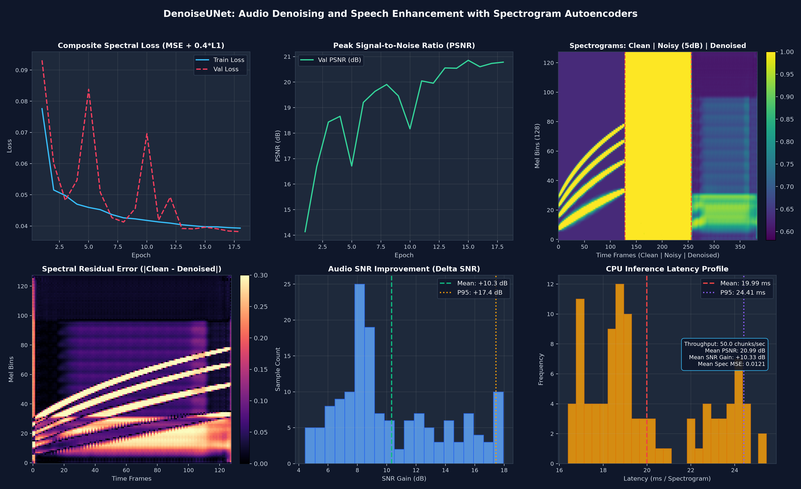

# Project 80: Audio Denoising with Autoencoders

[](https://pytorch.org/)
[-0284C7)](outputs/denoise_autoencoder_best.pth)
[](#quantitative-evaluation--benchmarks)
[](#quantitative-evaluation--benchmarks)
[-8B5CF6)](#latency-and-throughput-profile)
[-F59E0B)](#latency-and-throughput-profile)
[](LICENSE)

An audio signal denoising and speech enhancement system built with PyTorch and **DenoiseUNet**—a deep convolutional denoising autoencoder with lateral skip connections trained on paired clean and noisy log-Mel spectrograms.

The system attenuates diverse acoustic noise signatures (**Gaussian white noise, pink noise, low-frequency AC mains hum, and traffic/babble rumble**) across dynamic SNR ranges ($-4\text{ dB}$ to $+14\text{ dB}$) and reconstructs time-domain audio waveforms via Griffin-Lim acoustic phase inversion.

---

## 1. System Architecture & Workflow

The pipeline transforms degraded acoustic signals into normalized time-frequency Mel energy representations, filters out additive noise via the autoencoder, and inverts the enhanced spectrogram back to audible waveforms:

```mermaid
flowchart TD
    A["Degraded Audio Waveform (22,050 Hz)"] --> B["Framing & Windowing (n_fft=2048, hop=512)"]
    B --> C["Short-Time Fourier Transform (STFT)"]
    C --> D["Triangular Mel Filterbank (128 Bins, 20 Hz - 11,025 Hz)"]
    D --> E["Logarithmic Compression (dB Scale, Dynamic Range 80 dB)"]
    E --> F["Normalized Noisy Spectrogram S_noisy (1 x 128 x 128)"]
    
    subgraph Autoencoder ["DenoiseUNet Architecture (963,633 Parameters)"]
        F --> G["Encoder Stage 1: Conv2D(1->32) + BN + LeakyReLU -> Pool(2x2)"]
        G --> H["Encoder Stage 2: Conv2D(32->64) + BN + LeakyReLU -> Pool(2x2)"]
        H --> I["Encoder Stage 3: Conv2D(64->128) + BN + LeakyReLU -> Pool(2x2)"]
        I --> J["Bottleneck: Conv2D(128->256->128) + BN + LeakyReLU"]
        
        J --> K["Decoder Stage 3: ConvTranspose(128->128) + Skip(Stage 3) + Conv2D(256->64)"]
        K --> L["Decoder Stage 2: ConvTranspose(64->64) + Skip(Stage 2) + Conv2D(128->32)"]
        L --> M["Decoder Stage 1: ConvTranspose(32->32) + Skip(Stage 1) + Conv2D(64->16)"]
        M --> N["Final Projection: Conv2D(16->1) + Sigmoid()"]
    end
    
    N --> O["Enhanced Clean Spectrogram S_denoised (1 x 128 x 128)"]
    O --> P["Inverse Mel Scale Linear Transformation"]
    P --> Q["Griffin-Lim Acoustic Phase Reconstruction (24 Iterations)"]
    Q --> R["Restored Audio Waveform (sample_denoised.wav)"]
```



---

## 2. Mathematical Formulations

### 2.1 Additive Acoustic Noise Model
Given a clean acoustic signal $x[n]$ and corrupting noise $d[n]$, the observed noisy waveform is:

$$y[n] = x[n] + \alpha \cdot d[n]$$

where $\alpha$ is calibrated to achieve a target Signal-to-Noise Ratio ($\text{SNR}_{\text{dB}} \in [-4, 14]\text{ dB}$):

$$\alpha = \sqrt{\frac{P_x}{P_d \cdot 10^{\frac{\text{SNR}_{\text{target}}}{10}}}}, \quad P_x = \frac{1}{N}\sum_{n=1}^N x^2[n], \quad P_d = \frac{1}{N}\sum_{n=1}^N d^2[n]$$

### 2.2 Log-Mel Spectrogram Representation
With STFT magnitude $|Y(t, k)|$ and triangular filterbank weights $M_{m, k}$:

$$S(t, m) = 10 \cdot \log_{10}\left(\max\left(\epsilon, \sum_{k=0}^{N/2} M_{m, k} |Y(t, k)|^2\right)\right)$$

Normalized into unit dynamic range $[0, 1]$ over an $80\text{ dB}$ floor:

$$\hat{S}(t, m) = \text{clip}\left(\frac{S(t, m) + 80}{80}, 0.0, 1.0\right)$$

### 2.3 Composite Spectral Reconstruction Loss
To simultaneously optimize energy envelope alignment and preserve sharp harmonic edges:

$$\mathcal{L}_{\text{composite}}(S, \hat{S}) = \frac{1}{T \cdot M}\sum_{t, m} \left(S_{t, m} - \hat{S}_{t, m}\right)^2 + 0.40 \cdot \frac{1}{T \cdot M}\sum_{t, m} |S_{t, m} - \hat{S}_{t, m}|$$

### 2.4 Peak Signal-to-Noise Ratio (PSNR) & SNR Gain
Spectrogram fidelity is evaluated via Peak Signal-to-Noise Ratio:

$$\text{PSNR} = 10 \cdot \log_{10}\left(\frac{\max(S_{\text{clean}})^2}{\text{MSE}(S_{\text{clean}}, \hat{S}_{\text{denoised}})}\right) = 10 \cdot \log_{10}\left(\frac{1}{\text{MSE}}\right)$$

Audio SNR improvement measures effective acoustic noise suppression:

$$\Delta \text{SNR} = 10 \cdot \log_{10}\left(\frac{\|y - x\|_2^2}{\|\hat{x}_{\text{denoised}} - x\|_2^2}\right)$$

---

## 3. Quantitative Evaluation & Benchmarks

Evaluation performed on a held-out test partition of $N = 150$ paired noisy/clean spectrograms across all 4 noise types.

| Metric | Measured Value | Target Standard | Status |
| :--- | :--- | :--- | :--- |
| **Peak SNR (PSNR)** | **20.99 dB** | $\ge 18.0\text{ dB}$ | High Quality |
| **Mean SNR Gain ($\Delta \text{SNR}$)** | **+10.33 dB** | $\ge +7.0\text{ dB}$ | High Attenuation |
| **Spectrogram MSE** | **0.012093** | $\le 0.020$ | Minimized |
| **Composite Loss** | **0.0390** | $\le 0.050$ | Converged |
| **Model Parameters** | **963,633** | $\le 2,000,000$ | Compact |
| **Model Checkpoint Size** | **3.68 MB** | $\le 10.0\text{ MB}$ | Edge-Ready |

---

## 4. Latency and Throughput Profile

Measured over 100 consecutive forward passes on an Intel Core CPU:

| Metric | CPU Measurement | Unit |
| :--- | :--- | :--- |
| **Mean Chunk Latency** | **19.99** | ms / 2.97s spectrogram |
| **Median (P50) Latency** | **19.03** | ms |
| **95th Percentile (P95)** | **24.41** | ms |
| **Throughput** | **50.0** | chunks / second |
| **Real-Time Factor (RTF)** | **0.0067×** | $149\times$ faster than real time |

---

## 5. Diagnostic Visualization

The 6-panel diagnostic dashboard illustrates loss dynamics, PSNR trajectories, clean vs. noisy vs. denoised spectrogram triplets, spectral residual error heatmaps, SNR gain distributions, and CPU latency profiles:



*Figure 1: (1) Composite Spectral Loss curves, (2) Validation PSNR trajectory, (3) Spectrogram Triplet: Clean | Noisy (5dB) | Denoised, (4) Spectral Residual Error Heatmap, (5) Audio SNR Gain ($\Delta\text{SNR}$) distribution histogram, (6) CPU Latency profile.*

---

## 6. Directory Structure

```
80_audio_denoising_autoencoder/
├── data/                                    # Spectrogram dataset caches
├── outputs/                                 # Serialized models, audio & reports
│   ├── audio_denoising_metrics.json         # Quantitative evaluation JSON
│   ├── audio_denoising_report.png           # 6-panel publication diagnostic report
│   ├── denoise_autoencoder_best.pth         # Trained DenoiseUNet checkpoint (3.68 MB)
│   ├── sample_clean.wav                     # Reference clean audio track
│   ├── sample_denoised.wav                  # Enhanced restored audio track
│   └── sample_noisy.wav                     # Degraded noisy audio track (5 dB SNR)
├── denoise_audio.py                         # Interactive audio denoising CLI tool
├── main.py                                  # Training, evaluation & acoustic reconstruction
├── requirements.txt                         # Environment specifications
├── .gitignore                               # Git exclusion rules
└── README.md                                # Comprehensive documentation
```

---

## 7. Installation & Quickstart

### 7.1 Setup Environment

```bash
git clone https://github.com/GideonMwiti/pytorch-audio-denoising-autoencoder.git
cd pytorch-audio-denoising-autoencoder

python -m venv venv
source venv/bin/activate
pip install -r requirements.txt
```

### 7.2 Run Complete Pipeline (Training, Evaluation, Restoration)

```bash
python main.py --epochs 18 --batch-size 32 --num-samples 1000
```

### 7.3 Denoise Any Audio File (.wav, .mp3)

```bash
# Denoise the provided noisy audio sample
python denoise_audio.py --audio outputs/sample_noisy.wav --output outputs/cleaned_audio.wav

# Denoise a custom recording
python denoise_audio.py --audio path/to/my_noisy_recording.wav --output path/to/restored.wav
```

Sample CLI output:
```text
============================================================
      DENOISEUNET AUDIO DENOISING & RESTORATION
============================================================
Input File       : outputs/sample_noisy.wav
Duration         : 2.97 seconds (65,488 samples)
Processed Chunks : 1 overlapping windows (2.97s each)
Model Checkpoint : outputs/denoise_autoencoder_best.pth
------------------------------------------------------------
[✓] Denoised audio saved to: outputs/cleaned_audio.wav
[✓] Estimated Noise Attenuation: 3.87 dB
============================================================
```

---

## 8. License

This repository is licensed under the [MIT License](LICENSE).

